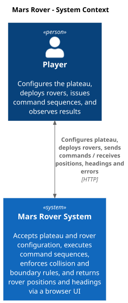

# 3. Context and Scope

## 3.1 Business Context

The Mars Rover system accepts commands from a player and returns the resulting state of rovers on a simulated Martian plateau. Everything inside the system boundary is built and owned by this project; everything outside is a human actor. There are no third-party APIs, authentication providers, payment gateways, or external data sources.

| Actor | What is exchanged | Direction |
|-------|-------------------|-----------|
| **Player** | Plateau dimensions, rover initial positions and headings, command strings; receives rover final positions, headings, and error messages | Player → System, System → Player |

## 3.2 Technical Context

The interfaces listed here are the ones that cross the system boundary. Internal calls between backend and domain logic belong in Chapter 5.

| Interface | Protocol / Channel | Description |
|-----------|--------------------|-------------|
| Player browser to React SPA | HTTP, static file serving | The compiled React bundle is served to the player's browser |
| React SPA to Mars Rover System | REST over HTTP/JSON | The SPA calls `/api/v1/` endpoints and receives JSON responses |

## 3.3 Scope

**In scope**

- Rectangular plateau configuration (upper-right coordinates)
- Deploying one or more rovers with an initial position and heading
- Executing `L`, `R`, `M` command sequences per rover
- Collision and out-of-bounds detection
- Reporting each rover's final position and heading
- Step-by-step command replay in the UI
- Browser-based grid visualisation of the plateau and rovers

**Out of scope**

- Persistence across process restarts (no database)
- Authentication or user accounts
- Multi-user or networked play (local only)
- Cloud or remote deployment
- Rover types beyond the basic kata model

