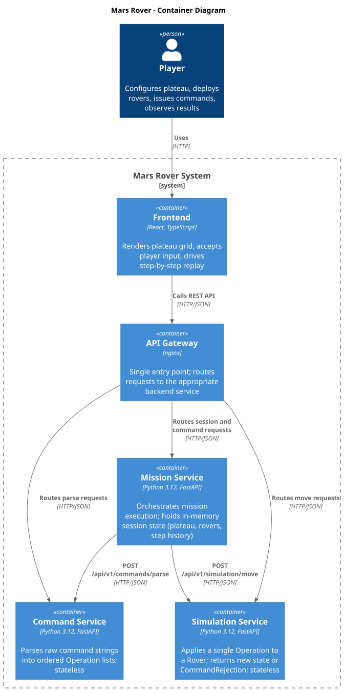
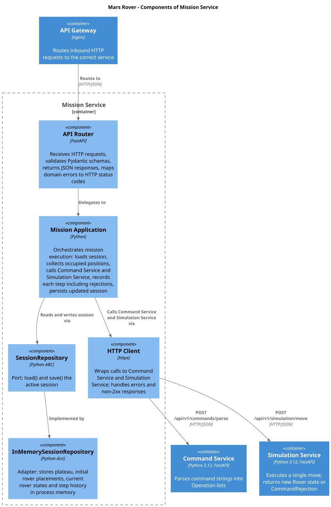
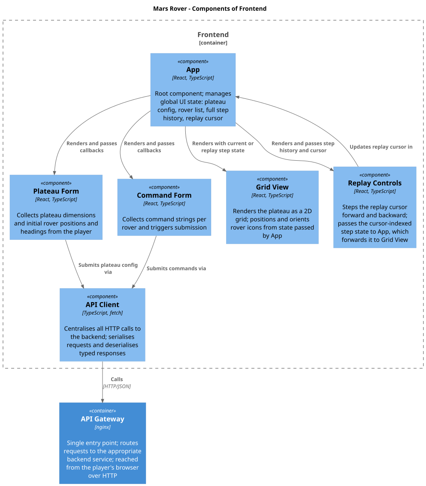

# 5. Building Block View

## 5.1 Level 1: Containers

The system consists of five containers orchestrated by Docker Compose. The three backend microservices each own their in-memory state and are never accessed directly by the frontend; all inbound traffic passes through the nginx reverse proxy.



| Container | Technology | Responsibility | Data owned |
|-----------|-----------|----------------|------------|
| **Frontend** | React, TypeScript | Renders the plateau grid and rover icons; collects plateau configuration and command strings from the player; drives step-by-step replay | Transient UI state (current view, replay cursor) |
| **API Gateway** | nginx | Single entry point; routes `/api/v1/session*` to Mission Service, `/api/v1/commands*` to Command Service, and `/api/v1/simulation*` to Simulation Service; serves no business logic | None |
| **Mission Service** | Python 3.12, FastAPI | Orchestrates end-to-end mission execution; holds the in-memory session (plateau, rovers, step history); calls Command Service and Simulation Service via HTTP | Active session: plateau dimensions, initial rover placements, current rover states, step history |
| **Command Service** | Python 3.12, FastAPI | Parses raw command strings into ordered `Operation` lists; rejects unknown characters | None (stateless) |
| **Simulation Service** | Python 3.12, FastAPI | Applies a single `Operation` to a `Rover` given `Plateau` dimensions and occupied positions; returns the new rover state or a `CommandRejection` | None (stateless) |

### Interfaces crossing container boundaries

| From | To | Protocol | Description |
|------|----|----------|-------------|
| Player browser | Frontend | HTTP | Static file serving of the compiled React bundle |
| Frontend | API Gateway | HTTP/JSON | All API calls: create session, submit commands, fetch history |
| API Gateway | Mission Service | HTTP/JSON | Proxied session management and command submission |
| API Gateway | Command Service | HTTP/JSON | Proxied command parsing requests |
| API Gateway | Simulation Service | HTTP/JSON | Proxied move execution requests |
| Mission Service | Command Service | HTTP/JSON | `POST /api/v1/commands/parse`: parse a command string |
| Mission Service | Simulation Service | HTTP/JSON | `POST /api/v1/simulation/move`: execute one move |

---

## 5.2 Level 2: Components

### Mission Service

The Mission Service is the orchestrator. It holds the only stateful in-memory store and drives the step-by-step execution loop.



#### Components

| Component | Layer | Responsibility | Data owned |
|-----------|-------|----------------|------------|
| **API Router** | Interface | Receives HTTP requests; validates request bodies via Pydantic schemas; serialises responses; maps domain errors to HTTP status codes | None |
| **Mission Service (app)** | Application | Orchestrates mission execution: loads the session, collects the set of occupied positions (excluding the moving rover), calls Command Service to parse commands, calls Simulation Service for each operation, records each step (including rejected moves), persists the updated session | None (coordinates other components) |
| **SessionRepository** | Application | Port (Python ABC): `load() -> Session` and `save(session: Session) -> None` | None (interface only) |
| **InMemorySessionRepository** | Infrastructure | Adapter: implements `SessionRepository` using a process-scoped Python dict | Plateau dimensions, initial rover placements, all current rover states, full step history |
| **HTTP Client** | Infrastructure | Wraps `httpx` calls to Command Service and Simulation Service; handles connection errors and non-2xx responses | None |

#### Internal calls

| From | To | Description |
|------|----|-------------|
| API Router | Mission Service (app) | Forwards validated request data; receives result or domain error |
| Mission Service (app) | HTTP Client | Calls Command Service (`parse`) and Simulation Service (`move`) |
| Mission Service (app) | SessionRepository | `load()` before execution; `save()` after each step is recorded |
| SessionRepository | InMemorySessionRepository | Delegation via Python ABC |

---

### Command Service

Stateless. Exposes one endpoint and contains only domain and interface layers.

| Component | Layer | Responsibility |
|-----------|-------|----------------|
| **API Router** | Interface | Receives `POST /api/v1/commands/parse`; validates input; returns ordered `Operation` list or error |
| **Command Parser** | Domain | Translates a raw command string (e.g. `"LMLM"`) into an ordered list of `Operation` values; raises `UnknownCommandError` on unrecognised characters |

---

### Simulation Service

Stateless. Exposes one endpoint and contains only domain and interface layers.

| Component | Layer | Responsibility |
|-----------|-------|----------------|
| **API Router** | Interface | Receives `POST /api/v1/simulation/move`; validates input; returns new `Rover` state or `CommandRejection` |
| **Simulation** | Domain | Given a `Rover`, an `Operation`, a `Plateau`, and a `frozenset[Position]` of occupied positions of all rovers *except* the moving one, returns a new immutable `Rover` (updated position and heading) or a `CommandRejection` |

---

### Frontend



| Component | Responsibility | Data owned |
|-----------|----------------|------------|
| **App** | Root component; manages global React state: plateau config, rover list, full step history, replay cursor | Session plateau, rover states, step history, replay cursor index |
| **Plateau Form** | Collects upper-right coordinates and initial rover positions and headings from the player | None |
| **Command Form** | Collects command strings per rover and triggers submission via API Client | None |
| **Grid View** | Renders the plateau as a 2D grid; positions and orients rover icons from the state App passes as props | None (purely presentational) |
| **Replay Controls** | Steps the replay cursor forward and backward; updates the cursor in App, which derives the display state for Grid View from the step history at that cursor index | Replay cursor index (lifted to App) |
| **API Client** | Centralises all `fetch` calls to the API Gateway; serialises request bodies; deserialises and types responses | None |

#### Internal calls

| From | To | Description |
|------|----|-------------|
| App | Plateau Form | Renders; receives `onSubmit` callback that calls API Client |
| App | Command Form | Renders; receives `onSubmit` callback that calls API Client |
| App | Grid View | Renders with current rover states or the step-indexed state derived from history |
| App | Replay Controls | Renders with step history and cursor; receives cursor-change callbacks |
| Plateau Form | API Client | `POST /api/v1/session` |
| Command Form | API Client | `POST /api/v1/session/commands` |
| Replay Controls | App | Increments or decrements replay cursor; App recomputes display state from history |
| API Client | API Gateway | HTTP/JSON; requests originate in the player's browser |

---

## Key Domain Types

| Type | BC / Service | Kind | Description |
|------|-------------|------|-------------|
| `Plateau` | Simulation | Value object | Immutable `(width, height)`; used to check boundary violations |
| `Heading` | Simulation | Enum | `N`, `E`, `S`, `W` |
| `Position` | Simulation | Value object | Immutable `(x, y)` coordinates; hashable so a `frozenset[Position]` can represent occupied cells |
| `Rover` | Simulation | Value object | Immutable `(position, heading)` pair; identity tracked by index in Mission Service |
| `Operation` | Simulation | Enum | `TURN_LEFT`, `TURN_RIGHT`, `MOVE_FORWARD`; defined in Simulation BC because it is what the simulation executes |
| `CommandRejection` | Simulation | Value object | Reason a move was refused: `OUT_OF_BOUNDS` or `COLLISION` |
| `Step` | Mission | Value object | One recorded move: `(rover_index, operation, resulting_position, resulting_heading, rejection: CommandRejection \| None)` |
| `Session` | Mission | Aggregate root | `plateau`, `initial_rovers: list[Rover]` (placement at session creation, never mutated; required for step-0 replay), `rovers: list[Rover]` (current states), `history: list[Step]` |

---

## Rejected-Move Behaviour

When the Simulation Service returns a `CommandRejection` (either `OUT_OF_BOUNDS` or `COLLISION`), the Mission Service:

1. Leaves the rover at its current position and heading (the move is not applied).
2. Still records a `Step` with the `rejection` field set to the rejection reason, so the step-by-step replay can visualise the failed attempt.

This means the step history is a complete log of all attempted moves, not only successful ones.

---

## API Endpoints

### Mission Service (via API Gateway)

| Method | Path | Description |
|--------|------|-------------|
| `POST` | `/api/v1/session` | Create or replace the active session with plateau and initial rover placements |
| `POST` | `/api/v1/session/commands` | Submit a command string for one rover; returns updated rover states and new steps |
| `GET` | `/api/v1/session/history` | Return the full step history for the active session |
| `DELETE` | `/api/v1/session` | Reset the active session |

### Command Service (internal, called by Mission Service)

| Method | Path | Description |
|--------|------|-------------|
| `POST` | `/api/v1/commands/parse` | Parse a raw command string; return ordered `Operation` list or `UnknownCommandError` |

### Simulation Service (internal, called by Mission Service)

| Method | Path | Description |
|--------|------|-------------|
| `POST` | `/api/v1/simulation/move` | Apply one `Operation` to a `Rover` on a `Plateau` with occupied positions; return new `Rover` or `CommandRejection` |

A single fixed session (no `{id}`) is consistent with the single-user, local-only constraint (ADR-005) and removes routing complexity with no trade-off.

---

## Step History Contract

The backend returns history as a list of `Step` records. Each step carries the full resulting state so the frontend never needs to re-execute domain rules to drive replay. Step 0 is the initial rover placement, derived from `Session.initial_rovers`.

```
Step {
  rover_index:          int
  operation:            "TURN_LEFT" | "TURN_RIGHT" | "MOVE_FORWARD"
  resulting_position:   { x: int, y: int }
  resulting_heading:    "N" | "E" | "S" | "W"
  rejection:            "OUT_OF_BOUNDS" | "COLLISION" | null
}
```
