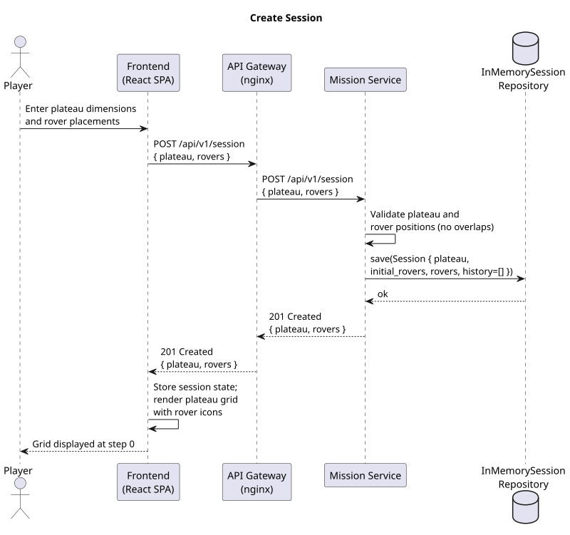
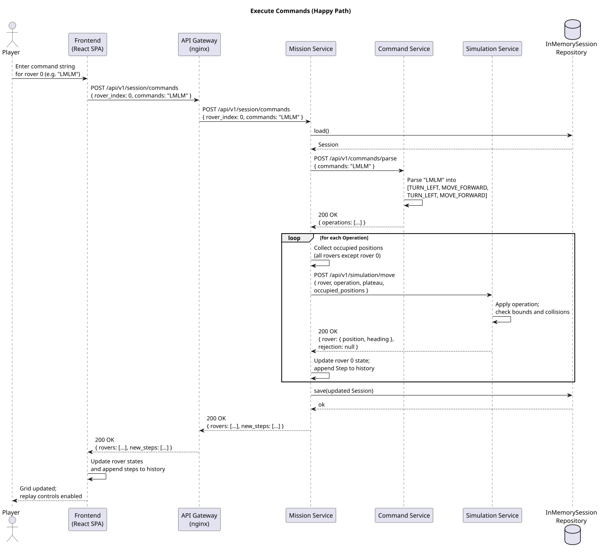
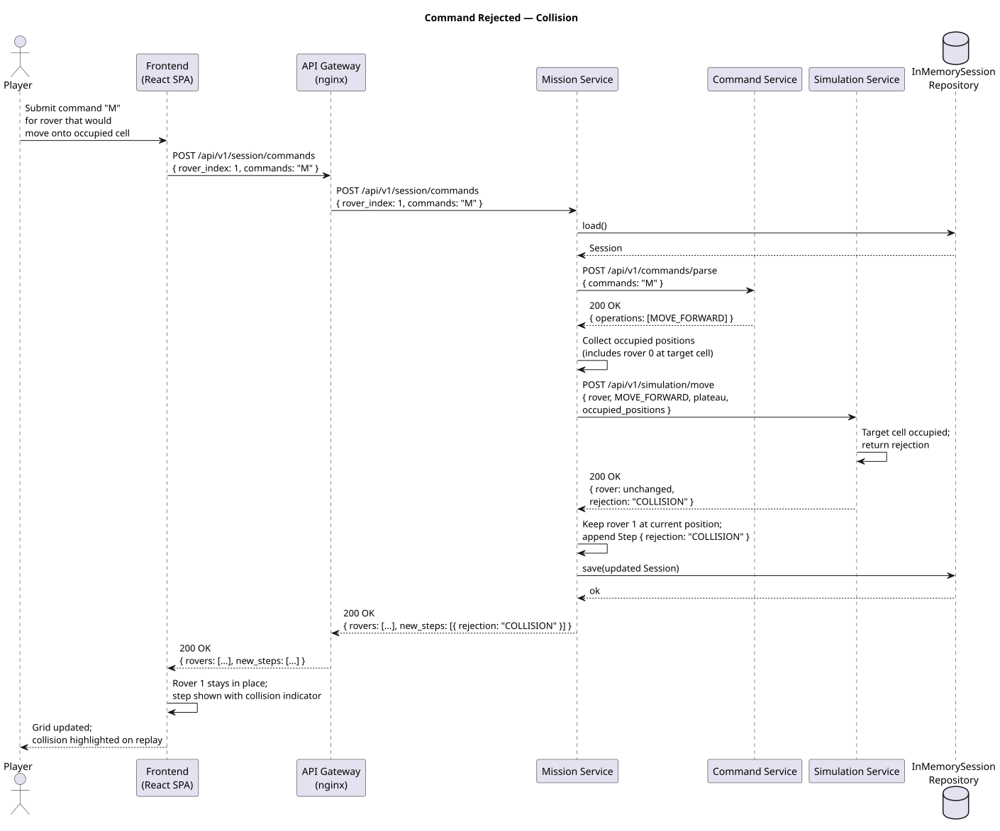
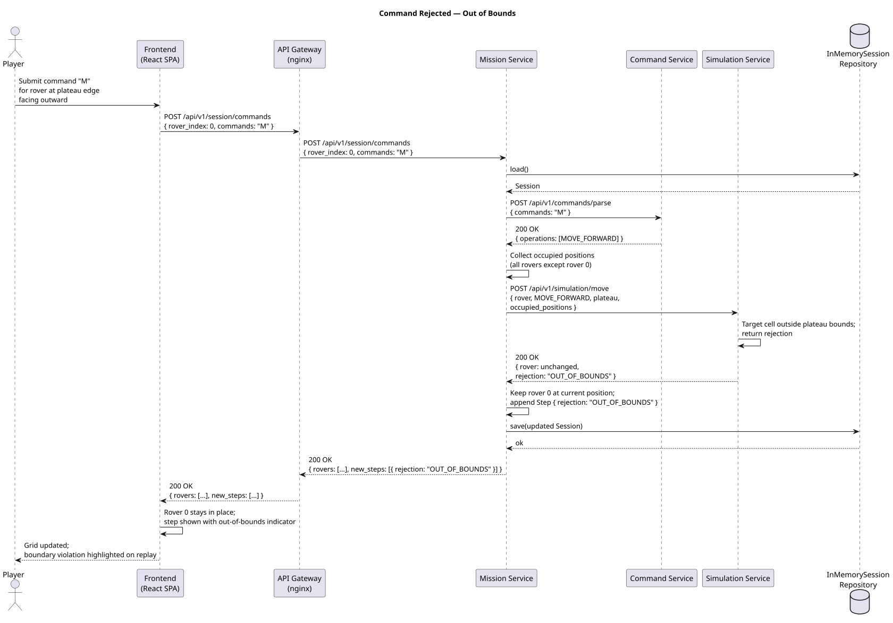
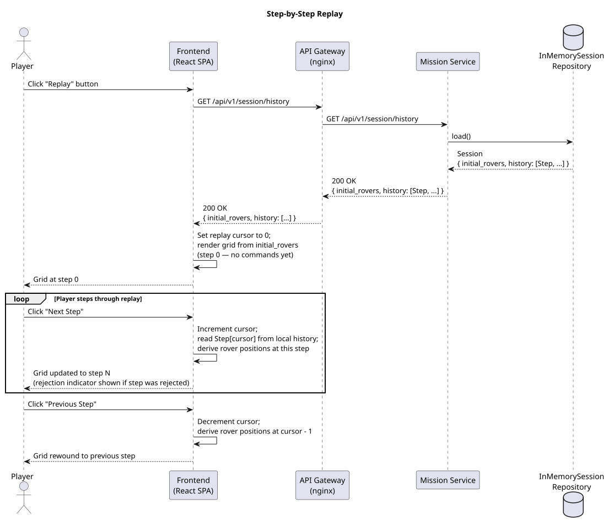

# 6. Runtime View

This chapter shows the five key runtime scenarios as sequence diagrams. All service-to-service calls cross the Docker Compose container network over HTTP/JSON. The Frontend never calls a backend service directly; every request is routed through the API Gateway (nginx).

---

## 6.1 Create Session

The player configures a plateau and places one or more rovers. The Mission Service validates that no two rovers share an initial cell, creates the session, and stores it in memory. `initial_rovers` is written once and never mutated; it anchors step-0 replay.

**Walkthrough:**

1. The player fills in plateau dimensions and rover placements in the Plateau Form and submits.
2. The Frontend posts `{ plateau, rovers }` to `POST /api/v1/session` via the API Gateway.
3. The Mission Service validates that no two rovers overlap and that all positions are within the plateau.
4. It saves a new `Session` with `plateau`, `initial_rovers` (snapshot), `rovers` (current state), and an empty `history`.
5. The Frontend receives the confirmed session and renders the plateau grid with rover icons at their initial positions (step 0).

**Error case:** If two rovers share an initial cell, the Mission Service returns `422 Unprocessable Entity` with a validation error; no session is created and the Frontend displays the error message.

---

## 6.2 Execute Commands: Happy Path

The player submits a command string for one rover. Every character is parsed into an `Operation` and each operation is executed one at a time, with the resulting state appended to the history after each step.

**Walkthrough:**

1. The player types a command string (e.g. `"LMLM"`) for rover 0 and submits via Command Form.
2. The Frontend posts `{ rover_index: 0, commands: "LMLM" }` to `POST /api/v1/session/commands`.
3. The Mission Service loads the current session, then calls `POST /api/v1/commands/parse` on the Command Service.
4. The Command Service returns the ordered `Operation` list `[TURN_LEFT, MOVE_FORWARD, TURN_LEFT, MOVE_FORWARD]`.
5. For each operation the Mission Service collects the occupied positions of all rovers except rover 0, then calls `POST /api/v1/simulation/move` on the Simulation Service.
6. The Simulation Service returns the new `Rover` state (`rejection: null`). The Mission Service updates rover 0 and appends a `Step` with no rejection.
7. After the loop the Mission Service saves the updated session and returns all updated rover states plus the new steps.
8. The Frontend appends the new steps to its local history and re-renders the grid.

---

## 6.3 Command Rejected: Collision

A `MOVE_FORWARD` would place a rover on a cell already occupied by another rover. The move is refused, the rover stays in place, and the rejection is recorded in the history so replay can show it.

**Walkthrough:**

1. The player submits `"M"` for rover 1, whose next cell is occupied by rover 0.
2. After parsing, the Mission Service collects occupied positions (which include rover 0's current position) and calls the Simulation Service.
3. The Simulation Service detects that the target cell is in `occupied_positions` and returns `{ rover: unchanged, rejection: "COLLISION" }`.
4. The Mission Service does not update rover 1's position. It appends a `Step` with `rejection: "COLLISION"` to the history.
5. The session is saved and the response is returned with HTTP 200. The rover's position in the response is unchanged.
6. The Frontend renders rover 1 in its original position and marks that step with a collision indicator in the replay controls.

---

## 6.4 Command Rejected: Out of Bounds

A `MOVE_FORWARD` would take a rover outside the plateau boundary. Behaviour is identical to a collision: the rover stays in place and a rejection step is recorded.

**Walkthrough:**

1. The player submits `"M"` for rover 0, which is at a plateau edge facing outward.
2. The Simulation Service computes the target cell and finds it falls outside `(0,0)–(width,height)`.
3. It returns `{ rover: unchanged, rejection: "OUT_OF_BOUNDS" }`.
4. The Mission Service keeps rover 0's position, appends a `Step` with `rejection: "OUT_OF_BOUNDS"`, saves the session, and responds with HTTP 200.
5. The Frontend renders rover 0 in its original position and marks the step with an out-of-bounds indicator.

---

## 6.5 Step-by-Step Replay

After commands have been submitted the player can step through the full history one move at a time. Replay is driven entirely client-side; no additional backend calls are made after the history is fetched.

**Walkthrough:**

1. The player clicks "Replay". The Frontend fetches `GET /api/v1/session/history`.
2. The Mission Service loads the session and returns `{ initial_rovers, history: [Step, ...] }`.
3. The Frontend sets the replay cursor to 0 and renders the grid from `initial_rovers` (the state before any command ran).
4. Each "Next Step" click increments the cursor. The Frontend reads `history[cursor]` and derives the rover positions at that step entirely from the local history array, with no further network calls.
5. Rejected steps are shown with a visual indicator (collision or out-of-bounds) so the player can see where and why a move failed.
6. "Previous Step" decrements the cursor and re-derives the grid state from the history up to that point.
