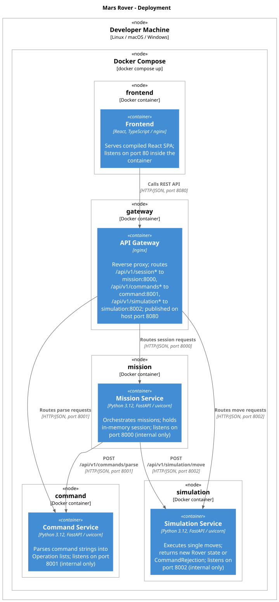

# 7. Deployment View

## 7.1 Infrastructure

The entire system runs on a single developer machine under Docker Compose. There is no cloud, no Kubernetes, and no paid infrastructure. A single `docker compose up` starts all five containers.

### Containers and port mapping

| Docker Compose service | Image built from | Internal port | Published on host | Notes |
|------------------------|-----------------|---------------|-------------------|-------|
| `frontend` | `frontend/Dockerfile` | 80 | 3000 | nginx serves the compiled React SPA |
| `gateway` | `gateway/nginx.conf` (official nginx image) | 80 | 8080 | Single externally reachable entry point for the API |
| `mission` | `mission/Dockerfile` | 8000 | (internal only) | Reachable on the compose network as `mission:8000` |
| `command` | `command/Dockerfile` | 8001 | (internal only) | Reachable on the compose network as `command:8001` |
| `simulation` | `simulation/Dockerfile` | 8002 | (internal only) | Reachable on the compose network as `simulation:8002` |

The player opens `http://localhost:3000` to access the UI. The SPA reaches the backend via `http://localhost:8080/api/v1/...`. The three microservice ports are not published to the host; they are only reachable within the Docker Compose network, enforcing that all external traffic passes through the gateway.

### nginx routing rules (gateway)

| URL prefix | Proxied to |
|------------|-----------|
| `/api/v1/session` | `http://mission:8000` |
| `/api/v1/commands` | `http://command:8001` |
| `/api/v1/simulation` | `http://simulation:8002` |

### Container network

All five containers join a single Docker Compose bridge network (`mars-rover-net`). Services discover each other by their Compose service name (e.g. `mission`, `command`, `simulation`). No external DNS or service registry is required.

---

## 7.2 Environments

| Environment | Description | How to run |
|-------------|-------------|-----------|
| **Local development** | All five containers on the developer machine | `docker compose up --build` |
| **Local development (services only)** | Backend services started without rebuilding the frontend image | `docker compose up mission command simulation gateway` |
| **CI** | Containers built and unit/integration tests run inside Docker | `docker compose -f docker-compose.test.yml run --rm tests` (Assumption: a separate test compose file is defined during implementation) |

There is no staging or production environment; the system is local-only by constraint (Chapter 2).

---

## 7.3 Microservice-to-container mapping

| Bounded context | Microservice | Compose service | Dockerfile location |
|----------------|-------------|-----------------|---------------------|
| Mission | Mission Service | `mission` | `services/mission/Dockerfile` |
| Command Parsing | Command Service | `command` | `services/command/Dockerfile` |
| Simulation | Simulation Service | `simulation` | `services/simulation/Dockerfile` |
| N/A | Frontend | `frontend` | `frontend/Dockerfile` |
| N/A | API Gateway | `gateway` | `gateway/` (nginx config + official image) |

Each Python service Dockerfile follows the same pattern: base image `python:3.12-slim`, install dependencies from `requirements.txt`, copy source, run `uvicorn` on the declared port. The frontend Dockerfile uses a two-stage build: `node:20-alpine` to compile the React app, then `nginx:alpine` to serve the static bundle.
